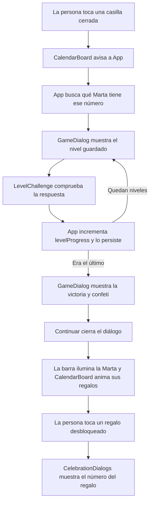

# Guía para entender y modificar el Martalendario

Esta guía describe la aplicación tal como está organizada ahora. El punto de partida es sencillo: **los textos y los datos de las siete Martas viven principalmente en `src/data/config.ts`; la lógica que coordina la aplicación está en `src/App.tsx`; los componentes presentan cada parte de la interfaz; y `src/hooks/useGameProgress.ts` guarda el progreso en el navegador**.

## 1. Mapa rápido del proyecto

```text
index.html
└── src/main.tsx
    ├── src/index.css
    └── src/App.tsx                         Coordina pantallas y estado
        ├── src/data/config.ts              Textos, Martas, regalos y pruebas
        ├── src/hooks/useGameProgress.ts    Lectura y guardado local
        ├── src/components/CalendarBoard.tsx
        ├── src/components/MartaBadgeRail.tsx
        ├── src/components/GameDialog.tsx
        │   ├── src/components/LevelChallenge.tsx
        │   ├── src/components/DialogFrame.tsx
        │   └── src/components/CharacterVideo.tsx
        └── src/components/CelebrationDialogs.tsx
            └── src/components/DialogFrame.tsx

src/types/game.ts                           Tipos compartidos de datos y progreso
public/videos/                              Vídeos y pósteres que utiliza la web
scripts/convert-videos.ps1                  Copia y convierte los vídeos fuente
```

El recorrido de una partida es:



Las flechas entre componentes son funciones `on...`: el componente hijo avisa de una acción y `App` decide qué estado actualizar. Así los componentes visuales no tienen que guardar por su cuenta la partida completa.

## 2. Qué hay en cada archivo

### Archivos de la raíz

| Archivo o carpeta | Para qué sirve |
| --- | --- |
| `index.html` | Documento inicial. Define idioma español, título, descripción, viewport para móvil y el elemento vacío `#root` donde React monta la web. |
| `package.json` | Nombre del proyecto, comandos disponibles y dependencias de React, Vite, Tailwind, Framer Motion, Lucide y canvas-confetti. |
| `package-lock.json` | Versiones concretas que npm instaló. Normalmente se conserva; npm lo actualiza al cambiar dependencias. |
| `vite.config.ts` | Activa los complementos de React y Tailwind para Vite. |
| `tsconfig.json` | Ajustes de TypeScript. Está en modo estricto y comprueba los archivos de `src`. |
| `README.md` | Resumen breve del proyecto y comandos básicos. Esta guía amplía esa información. |
| `*.webm` | Siete vídeos fuente: `little_marta.webm`, `lovely_marta.webm`, `artist_marta.webm`, `hungry_marta.webm`, `traveling_marta.webm`, `music_marta.webm` y `beauty_marta.webm`. El script los lee desde aquí. |
| `scripts/convert-videos.ps1` | Script de PowerShell que copia los WebM a `public/videos` y genera las versiones MOV y los pósteres PNG. |
| `public/videos/` | Archivos estáticos que el navegador descarga: por cada Marta hay un `.webm`, un `.mov` y un `-poster.png`. |
| `dist/` | Resultado generado al compilar para producción. No es la carpeta donde se edita la aplicación. |
| `node_modules/` | Paquetes instalados por npm. No se editan a mano. |

### Archivos de `src/`

| Archivo | Responsabilidad |
| --- | --- |
| `src/main.tsx` | Punto de entrada de React. Busca `#root`, carga `App` y la hoja de estilos. |
| `src/App.tsx` | Orquesta bienvenida, reglas y tablero; selecciona la Marta según una casilla; coordina diálogos, progreso, confeti indirectamente y mensajes temporales. Es el lugar para entender el flujo completo antes de tocarlo. |
| `src/index.css` | Estilos globales y de los componentes: paleta, bordes, sombras, tamaños, cuadrícula, modales y adaptación a pantallas pequeñas. También incluye estados para movimiento reducido y colores de alto contraste. |
| `src/vite-env.d.ts` | Declara los tipos de entorno de Vite para TypeScript. No contiene lógica de la aplicación. |
| `src/types/game.ts` | Contratos de TypeScript compartidos: identificadores de Marta, formatos de nivel, estructura de una Marta y forma del progreso persistido. |
| `src/data/config.ts` | Configuración editable: textos comunes, reparto de regalos, orden visual del tablero y definición de cada Marta con sus niveles. |
| `src/hooks/useGameProgress.ts` | Hook que inicializa, sanea, lee y guarda el progreso en `localStorage`. |

### Archivos de `src/components/`

| Archivo | Qué dibuja o hace |
| --- | --- |
| `CalendarBoard.tsx` | El tablero de 24 casillas. Decide cuáles están bloqueadas, desbloqueadas o abiertas. Para una casilla normal busca a su propietaria; la casilla 24 comprueba si todas las Martas se completaron. Añade la animación de desbloqueo escalonada. |
| `MartaBadgeRail.tsx` | La barra indicadora «Las siete Martas». No inicia juegos: muestra los emojis en oscuro mientras están bloqueados y en color al completarlos; encima coloca el vídeo de la Marta desbloqueada. |
| `GameDialog.tsx` | La ventana del minijuego. Muestra título, instrucciones y avance de niveles; al finalizar cambia al panel de victoria y dispara confeti. |
| `LevelChallenge.tsx` | Presenta y comprueba la prueba actual. Tiene una rama para cada tipo de nivel: opción múltiple, palabra escrita u orden de pasos. |
| `DialogFrame.tsx` | Contenedor común de diálogo HTML nativo (`<dialog>`), con apertura modal, botón de cierre y callback de cierre. Lo comparten el juego, los regalos y el final. |
| `CelebrationDialogs.tsx` | Contiene `GiftDialog`, para mostrar qué regalo físico abrir, y `FinalDialog`, para el premio de la casilla 24 y su lluvia dorada de confeti. |
| `CharacterVideo.tsx` | Construye las rutas de vídeo a partir del identificador de la Marta y controla la reproducción/pausa. Ofrece MOV y WebM y usa el póster PNG como imagen de apoyo. |

## 3. Cómo se relacionan los datos

### `MartaId` y la definición de una Marta

En `src/types/game.ts`, `MartaId` es una unión de siete valores permitidos: `little`, `lovely`, `artist`, `hungry`, `traveling`, `music` y `beauty`. TypeScript puede detectar una errata en un identificador porque no acepta cualquier texto.

Cada entrada de `martas` en `src/data/config.ts` es una `MartaDefinition`. Sus campos son:

- `id`: identificador técnico, usado también para componer los nombres de vídeo.
- `name`, `title`, `description`: nombre visible, subtítulo y descripción de la personalidad.
- `emoji`: símbolo de la barra y del encabezado del minijuego.
- `color`: sufijo de clase CSS que da estilo a esa personalidad en la barra.
- `giftNumbers`: números de casilla que desbloquea.
- `gameTitle`, `gameIntro`: título e introducción de su juego.
- `levels`: pruebas consecutivas. La longitud de este array determina cuántas pruebas necesita esa Marta.

`martaById` es un índice construido desde `martas` para que `App` encuentre rápidamente una Marta a partir de su `id`. Los nombres y textos están centralizados para poder editarlos sin buscar cadenas por varios componentes.

### Reparto de las casillas

`giftNumbersByMarta` es el lugar principal para cambiar el reparto. Ahora asigna las casillas 1–23 así: Little, Lovely, Artist, Hungry y Traveling tienen tres cada una; Music y Beauty tienen cuatro cada una. Los arrays se enlazan a `giftNumbers` de cada definición.

Mantén estas reglas cuando edites el reparto:

1. Cada número normal del 1 al 23 debe aparecer **una sola vez** entre las siete listas.
2. No asignes el 24 a una Marta: está reservado al premio final.
3. `calendarOrder` debe contener los números del 1 al 24 una vez cada uno. Cambiar su orden cambia únicamente la posición de las casillas, no quién las desbloquea.
4. La propietaria se obtiene buscando qué Marta incluye el número en `giftNumbers`; no hay otra tabla oculta de propietarios.

En `CalendarBoard`, una casilla normal se considera lista cuando su Marta está en `completedMartaIds`. Si la casilla está cerrada, al pulsarla `App` busca la Marta dueña y abre su juego. Cuando la misma casilla ya está desbloqueada, el clic abre el regalo y lo marca como abierto. Por eso un juego completado no vuelve a iniciarse desde esos regalos.

### Los tres formatos de nivel

El tipo `GameLevel` es una unión discriminada. El campo `kind` le dice a `LevelChallenge` cómo interpretar el resto de los datos:

| `kind` | Datos principales | Cómo se juega |
| --- | --- | --- |
| `choice` | `prompt`, `options`, `answer` y opcionalmente `hint` | Se elige una opción y se comprueba si coincide con `answer`. |
| `word` | `prompt`, `clue`, `answer` | Se escribe la palabra. La comparación ignora mayúsculas, espacios exteriores y tildes. |
| `order` | `prompt`, `detail`, `items`, `correctOrder` | Se tocan elementos para construir una secuencia y se compara con el orden correcto. |

Los juegos actuales usan estos formatos: Little, Artist, Hungry, Traveling y Music usan `choice`; Lovely usa `word`; Beauty usa dos niveles `order` (rutina de skincare y rutina de maquillaje). Seis Martas tienen tres niveles y Beauty tiene dos. El progreso y el contador del diálogo usan `levels.length`, así que añadir o quitar una prueba de una Marta existente se hace editando su array.

Si inventas un cuarto formato, además de añadir sus preguntas en `config.ts`, tendrás que definir su tipo en `src/types/game.ts` y añadir en `LevelChallenge.tsx` la interfaz y la comprobación de respuesta correspondientes. Si solo cambias preguntas de un formato existente, no hace falta cambiar los componentes.

## 4. Qué ocurre con el estado y cómo se guarda

`App.tsx` contiene el estado temporal de la interfaz: pantalla visible, juego activo, diálogo de regalo o final, mensaje emergente, animación reciente y pausa de los vídeos. El hook `useGameProgress` posee el estado que debe sobrevivir a una recarga.

El objeto persistido tiene estos campos:

| Campo | Significado |
| --- | --- |
| `version` | Versión del formato guardado. Ahora es `1`. |
| `rulesSeen` | Si ya se pasó de las reglas al tablero. Al volver, permite iniciar directamente en el tablero. |
| `completedMartaIds` | Martas que ya completaron todas sus pruebas. |
| `levelProgress` | Número de pruebas ya superadas por cada Marta. Con esto, al volver a un juego incompleto se reanuda en el nivel siguiente. |
| `openedGiftNumbers` | Regalos numerados que ya se abrieron en la web. |
| `finalOpened` | Si se abrió el premio final 24. |

La clave de almacenamiento del navegador es `martalendario-progress-v1`. El hook intenta leerla al cargar, comprueba la versión y limita los valores a rangos válidos; después escribe el estado actualizado automáticamente. Si el navegador bloquea `localStorage`, la aplicación sigue funcionando durante esa sesión, aunque no podrá conservar el progreso al cerrar.

El progreso pertenece a ese navegador y dispositivo, no a una cuenta: otro móvil, otro navegador o una ventana privada empieza con su propio estado. Para empezar de cero en el navegador actual, abre las herramientas de desarrollo y ejecuta en la consola:

```js
localStorage.removeItem('martalendario-progress-v1');
location.reload();
```

Si algún día cambias la estructura de `PersistedProgress`, tendrás que pensar también en compatibilidad: `readProgress` solo reconoce ahora la versión 1. Para una prueba personal, borrar la clave suele bastar; para conservar partidas existentes, habría que escribir una migración de datos.

## 5. La ruta de desbloqueo, paso a paso

1. La primera visita empieza en bienvenida. Continuar muestra las reglas; «¡Entendido!» marca `rulesSeen` y lleva al tablero.
2. `CalendarBoard` llama a `onLocked(numero)` cuando la casilla está cerrada. `App.selectCalendarCell` busca su propietaria en la configuración y establece `activeMartaId`.
3. `GameDialog` lee el nivel actual de `levelProgress`. `LevelChallenge` valida la respuesta y avisa con `onSolved()` cuando es correcta.
4. `App.solveLevel` incrementa el progreso. Al llegar al total de `levels`, añade la Marta a `completedMartaIds`.
5. `GameDialog` detecta que se completó el juego, muestra la ventana de victoria, el vídeo y el confeti. La descripción y la lista de regalos salen de la propia configuración.
6. Continuar cierra el juego. `App.closeGame` pone esa Marta en `revealMartaId`; `MartaBadgeRail` y `CalendarBoard` reciben ese identificador para animar el emoji, el vídeo y las casillas asignadas. La señal de animación se limpia aproximadamente a los 1,8 segundos.
7. A partir de ahí las casillas de esa Marta abren sus regalos. La casilla 24 se vuelve seleccionable cuando las siete aparecen completadas.

El estado que hace que un premio esté desbloqueado es `completedMartaIds`. `openedGiftNumbers` solo registra que se ha abierto una ventana de regalo; no es lo que desbloquea las otras casillas.

## 6. Vídeos transparentes

Los vídeos fuente viven en la raíz, pero la web los sirve desde `public/videos/`. `scripts/convert-videos.ps1` recorre los siete identificadores (`little`, `lovely`, `artist`, `hungry`, `traveling`, `music`, `beauty`) y por cada uno:

1. Busca `<id>_marta.webm` en la raíz del proyecto y copia ese WebM a `public/videos/`.
2. Convierte el vídeo a `<id>_marta.mov`, con ProRes 4444 y alfa, escalado a 320 px de ancho.
3. Genera `<id>_marta-poster.png` para usar como póster.
4. Usa `ffprobe` para comprobar que el MOV conserva un formato de píxel con alfa.

FFmpeg y ffprobe deben estar instalados; el script busca `ffmpeg.exe` en el `PATH` y también intenta localizar instalaciones de WinGet. Si hace falta, `FFMPEG_PATH` puede indicar la ruta completa al ejecutable. Para regenerar los archivos tras sustituir un vídeo fuente, desde PowerShell en la carpeta del proyecto ejecuta:

```powershell
./scripts/convert-videos.ps1
```

`CharacterVideo.tsx` calcula la ruta a partir del `id` y declara primero MOV (`video/quicktime`, códec `ap4h`) y después WebM (`vp9`). El navegador puede elegir una fuente compatible. El elemento usa reproducción en bucle, sin sonido y en línea; también solicita reproducir o pausar según la propiedad `play`. Algunos navegadores móviles pueden esperar a una interacción antes de permitir autoplay.

Si añades otra Marta, su `id` debe coincidir en la configuración, el nombre del WebM de la raíz y la lista `videoIds` del script; el resultado debe llamarse `<id>_marta.mov` y `<id>_marta-poster.png` dentro de `public/videos/`. Los MOV ocupan más que los WebM, así que conviene tener en cuenta el peso de descarga móvil.

## 7. Cómo modificar las cosas habituales

### Cambiar textos o preguntas

Abre `src/data/config.ts` y edita `appCopy` para la bienvenida, las reglas y el mensaje final. Para cambiar un juego, localiza la Marta y modifica `gameTitle`, `gameIntro` o las propiedades de los niveles. En preguntas de opción múltiple, `answer` tiene que ser exactamente igual a una opción de `options`.

### Cambiar el número de niveles de una personalidad

Añade, elimina o reordena objetos dentro de `levels` en `src/data/config.ts`. El indicador del juego y la condición de completar usan la longitud de ese array. Al probarlo, recuerda que el navegador quizá ya tenga guardado un avance antiguo de esa Marta; borra el progreso local si quieres revisar la experiencia desde el primer nivel.

### Cambiar colores, tamaños y distribución

La mayoría de estilos concretos están en `src/index.css`. Las variables de color y de sombra están al principio, bajo `:root`. Busca las clases por la parte de la pantalla: `welcome-*`, `rules-*`, `board-*`, `progress-*`, `calendar-*`, `dialog-*`, `challenge-*`, `win-*` o `final-*`. En el mismo archivo hay ajustes para pantallas de 640 px o más, para teléfonos muy estrechos (360 px o menos) y para preferencias de movimiento reducido.

El proyecto carga Tailwind CSS 4 con `@import "tailwindcss"` y el complemento de Vite. Hay algunas clases utilitarias en el JSX, pero el diseño detallado está escrito con clases propias en `src/index.css`.

### Añadir o quitar una personalidad

No basta con copiar una entrada en `config.ts`. También habría que actualizar `MartaId` en `src/types/game.ts`, el reparto, los textos de reglas/final y las cifras que ahora están expresadas como siete en `App.tsx` y `MartaBadgeRail.tsx`; la barra tiene siete columnas definidas en `src/index.css`. Revisa también los vídeos y el script de conversión. El hook inicializa automáticamente el avance para los identificadores presentes en `martas`, pero los límites y textos visuales también deben coincidir con el nuevo total.

### Cambiar el aspecto de las animaciones

Framer Motion se usa en los componentes y en `App.tsx`: busca `motion.*`, `initial`, `animate`, `transition` o `whileTap`. La celebración usa `canvas-confetti` en `GameDialog.tsx` y en `CelebrationDialogs.tsx`. Los iconos importados de Lucide React se declaran al principio del archivo que los usa.

## 8. Comandos para trabajar con el proyecto

En PowerShell, desde `C:\Users\josek\OneDrive\Escritorio\regalomarta`:

```powershell
npm install
npm run dev
```

Vite muestra una dirección local para abrir la web. El script `dev` escucha en la red (`--host 0.0.0.0`), algo útil para probarla desde otro dispositivo conectado a la misma red.

Para generar la compilación de producción:

```powershell
npm run build
```

Este comando ejecuta primero la comprobación de TypeScript (`tsc --noEmit`) y luego genera `dist/`. Para servir esa compilación localmente:

```powershell
npm run preview
```

Si TypeScript señala un error después de editar, empieza por leer el nombre del archivo y la línea del mensaje. Errores comunes al cambiar la configuración son escribir un `id` que no esté en `MartaId`, olvidar una propiedad obligatoria del tipo de nivel o poner una respuesta que no coincide con ninguna opción.

## 9. Pistas para orientarte al leer el código

- Un `import` al principio del archivo indica de dónde viene una función, un componente, un tipo o un paquete externo.
- Un `type ...Props` describe qué datos recibe un componente. Por ejemplo, `CalendarBoard` recibe el progreso y callbacks para las casillas.
- `useState` guarda un valor que cambia en la interfaz. Cuando cambia, React vuelve a dibujar esa parte.
- `useEffect` se usa aquí para efectos secundarios como guardar en el navegador, abrir/cerrar un diálogo o programar la desaparición de un mensaje.
- `onClick`, `onSolved` y nombres parecidos conectan una acción del usuario con una función del componente padre.
- Las expresiones `{...}` dentro del JSX insertan valores de JavaScript en el marcado; `.map(...)` repite un elemento para cada entrada de un array.
- En `LevelChallenge`, las comprobaciones `level.kind === 'choice'` y similares permiten que TypeScript sepa qué campos son válidos para cada prueba.
- Mantén los vídeos que se publican en `public/videos/` con los nombres que espera `CharacterVideo`. Vite sirve los archivos de `public` directamente desde la raíz de la web.

## 10. Resumen: dónde tocar según lo que quieras cambiar

| Quiero cambiar… | Empiezo por… |
| --- | --- |
| Preguntas, pistas o respuestas | `src/data/config.ts` → `levels` |
| Nombre, emoji, descripción o título de una Marta | `src/data/config.ts` → entrada de esa Marta |
| Qué regalos desbloquea cada una | `src/data/config.ts` → `giftNumbersByMarta` |
| Orden de las casillas | `src/data/config.ts` → `calendarOrder` |
| Mensajes de bienvenida, reglas y gran final | `src/data/config.ts` → `appCopy` |
| Cómo se valida o presenta una prueba | `src/components/LevelChallenge.tsx` |
| Cómo se ve una pantalla, barra, casilla o modal | `src/index.css` y el componente correspondiente |
| Qué pasa al completar, cerrar o abrir una casilla | `src/App.tsx` |
| Qué se conserva tras recargar | `src/hooks/useGameProgress.ts` y `src/types/game.ts` |
| Vídeo, póster o fuente compatible | archivo fuente en la raíz, `scripts/convert-videos.ps1`, salida en `public/videos/` y `src/components/CharacterVideo.tsx` |
| Entrada del sitio, título de pestaña o metadatos | `index.html` |

